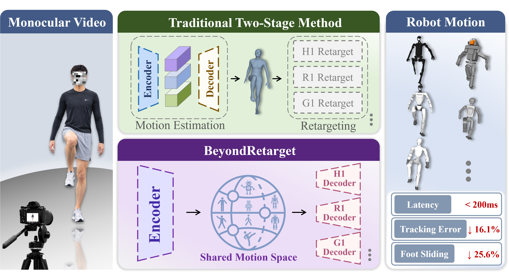
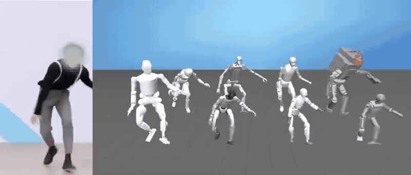

<h1 align="center">BeyondRetarget Plus: Global Trajectory-Aware Humanoid Retargeting</h1>

<div align="center">
  <a href="https://bear-ty.github.io/bear_ty/" target="_blank">Tianyu Xiong</a><sup>1,*</sup>&emsp;
  <a href="https://yeelou.github.io/" target="_blank">Yi Lu</a><sup>1,*</sup>&emsp;
  Jinrui Wang<sup>1</sup>&emsp;
  Ziqi Liang<sup>1</sup>&emsp;
  <br>
  Dandan Lei<sup>3</sup>&emsp;
  Xiaoyang Zhou<sup>4</sup>&emsp;
  Xiao-xiao Long<sup>2</sup>&emsp;
  <a href="https://shenqiu.njucite.cn/" target="_blank">Qiu Shen</a><sup>1,&dagger;</sup>&emsp;
  <a href="https://cite.nju.edu.cn/People/Faculty/20190621/i5054.html" target="_blank">Xun Cao</a><sup>1</sup>
</div>
<div align="center">
  <sup>1</sup>School of Electronic Science and Engineering, Nanjing University, Nanjing, China
  <br>
  <sup>2</sup>School of Intelligence Science and Technology, Nanjing University, Suzhou, China
  <br>
  <sup>3</sup>Jiangsu Mobile Information System Integration Co., Ltd., Nanjing, China
  <br>
  <sup>4</sup>China Mobile Zijin (Jiangsu) Innovation Research Institute Co., Ltd., Nanjing, China
</div>
<div align="center">
  <sup>*</sup>Equal Contribution&emsp;
  <sup>&dagger;</sup>Corresponding Author
</div>
<div align="center">
  <a href="https://bear-ty.github.io/Beyondretarget_page/"></a>
  <a href="https://huggingface.co/spaces/bear-ty/BeyondRetarget"></a>
  <a href="https://arxiv.org/abs/2609.29850"></a>
</div>

<div align="center">
  <h2>🚀 This is the BeyondRetarget Plus code release</h2>
  <p><strong>The research/global-trajectory extension of the real-time BeyondRetarget base release.</strong></p>
  <p>Base repository: <a href="https://github.com/bear-ty/BeyondRetarget">github.com/bear-ty/BeyondRetarget</a></p>
</div>

🤖 BeyondRetarget Plus extends the base method with global trajectory modeling,
moving-camera support, and delivers stronger generalization capability and motion reconstruction performance. The
<strong>BeyondRetarget base version</strong> remains the recommended release for
real-time teleoperation, while Plus is intended for research and offline use.

| Release | Main capability | Repository |
| --- | --- | --- |
| **BeyondRetarget (base)** | Real-time monocular-video humanoid retargeting and teleoperation | [Base code](https://github.com/bear-ty/BeyondRetarget) |
| **BeyondRetarget Plus** | Global trajectories, moving-camera preprocessing, training, and evaluation | This repository |

The public code and project website currently present the **BeyondRetarget base
version**. It is designed for real-time teleoperation, but does not yet cover
moving cameras or large-scale global human trajectories. BeyondRetarget Plus is
the research version for these settings.



### 🎬 BeyondRetarget Base preview

The shared project demo shows the base method on eight robots, comparisons
with other methods, and **real-time teleoperation**:

<p align="center">
  
</p>

### 👀 BeyondRetarget Plus preview

The demo showcases **highly dynamic motions and large-scale movement**, and with
**stable foot contact without sliding in the tennis scene**.

<p align="center">
  
</p>


## 📋 Todo List

- [x] Release the **base version**, pretrained weights, and inference tools for eight humanoid robots.
- [x] Support offline video inference and real-time streaming for teleoperation.
- [x] **Open-source BeyondRetarget Plus**, supporting motions across nearly all scenarios, including **skating, gymnastics, walking, and running**.

## Installation

Requires Linux x86_64, Python 3.10, and a CUDA-capable PyTorch installation.

```bash
git clone https://github.com/bear-ty/BeyondRetarget_plus.git BeyondRetarget_plus
cd BeyondRetarget_plus
bash scripts/setup_environment.sh
conda activate BeyondRetarget_plus
python scripts/check_installation.py
```

The setup script creates the environment, installs the dependencies, and
downloads the shared robot assets, YOLOv8x weights, and the Plus checkpoint
from the [BeyondRetarget Google Drive folder](https://drive.google.com/drive/folders/12ySWLbVhF8WEGyLR0Ll09DmZm8rZE0Tg).
SMPL files and datasets must be downloaded separately under their own terms.

## Resources

The shared Drive folder provides:

- `robot.zip`, containing the supported robot URDF/MJCF files and meshes;
- `yolov8x.pt`, used for extracting person boxes from videos;
- `beyondretarget_plus_8robots.pth`, a complete Plus checkpoint containing the
  frozen TRAM/VIMO backbone, eight robot heads, and the shared static head.

The supported robots are Unitree G1, Unitree R1, Fourier GR1-T1,
Fourier GR2-V3, Unitree H1, Booster T1, Tienkung, and Atlas.

The Plus checkpoint does not require a separate VIMO checkpoint for inference.
Root motion remains the native frozen TRAM/VIMO output, and post-processing uses
the full C-RC1 reprojection pipeline.

Download the licensed neutral SMPL model from the
[SMPL website](https://smpl.is.tue.mpg.de/) and place `SMPL_NEUTRAL.pkl` in
`data/smpl/`. Download and prepare the BEDLAM, H36M, 3DPW, and EMDB resources
following the [TRAM instructions](https://github.com/yufu-wang/tram).

The optional moving-camera frontend uses TRAM's DROID-SLAM, SAM, DEVA,
ZoeDepth, and SPEC/camcalib components. Their checkpoints and licenses remain
external; use `scripts/download_models.sh` after completing the required
registrations.

## Dataset preprocessing

TRAM provides [preprocessed training data (such as crops) and annotations](https://drive.google.com/drive/folders/1kTrsfZRfWjZOnwNn-5OOyvmVCCXoGBUG?usp=share_link)
for the supported datasets except BEDLAM. Download those resources and update
`data_config.py` to point to the correct paths. For BEDLAM, download the
**30 fps version** (for example, the MP4 files) from the
[official BEDLAM website](https://bedlam.is.tue.mpg.de) under its terms, then
use the included helpers to extract and crop it into the required format:

```bash
python scripts/extract_bedlam_jpg.py --help
python scripts/crop_datasets.py --help
```

If a sequence contains SMPL parameters but no `keypoints.npy`, generate the
SMPL joints with the licensed neutral model:

```bash
python scripts/generate_smpl_keypoints.py \
  --dataset_root /path/to/sequence \
  --smpl_model data/smpl/SMPL_NEUTRAL.pkl
python scripts/validate_dataset.py /path/to/sequence
```

For video input, extract a continuous person track with YOLOv8x:

```bash
python scripts/extract_video_boxes.py \
  --video path/to/video.mp4 \
  --weights assets/yolo/yolov8x.pt \
  --output outputs/boxes.npz
```

## Inference and post-processing

Run the complete Plus pipeline with the merged eight-robot checkpoint:

```bash
python scripts/infer_beyondretarget.py \
  --cfg configs/config_beyondretarget_motion_g1.yaml \
  --video path/to/video.mp4 \
  --boxes outputs/boxes.npz \
  --checkpoint assets/checkpoints/beyondretarget_plus_8robots.pth \
  --camera-trajectory outputs/camera.npy \
  --keypoints outputs/keypoints.npy \
  --confirm-single-shot \
  --output outputs/final_motion.npz
```

The normal output always includes full C-RC1 reprojection. Use `--raw-only`
only when inspecting intermediate predictions or running metrics.

For camera estimation and visualization, use:

```bash
python scripts/prepare_robot_video_camera.py --help
python scripts/visualize_tram.py --help
python scripts/render_robot_video.py --help
```

## Training

Training uses processed TRAM data and either cached frozen features or the
official VIMO checkpoint:

```bash
python scripts/cache_tram_robot_features.py \
  --cfg configs/config_beyondretarget_motion_g1.yaml \
  --output outputs/feature_cache/vimo_decoder46_16f_v2
python scripts/train_beyondretarget.py \
  --cfg configs/config_beyondretarget_motion_g1.yaml
python scripts/train_static_head.py \
  --config configs/config_beyondretarget_motion_camera_static.yaml --launch
```

The PARE/TRAM synthetic-occlusion augmentation is optional. Download its
Pascal resource with `bash scripts/download_pascal_occluders.sh` and enable it
with `DATASET.OCCLUSION=true` when needed.

## Evaluation and tests

```bash
python scripts/eval_beyondretarget.py --help
python scripts/emdb/run_cam.py --data-root /path/to/emdb
python scripts/emdb/run_smpl.py --data-root /path/to/emdb
python scripts/emdb/run_eval.py --data-root /path/to/emdb
python scripts/evaluate_robot_motion_predictions.py --help
python -m unittest discover -s tests -p 'test_*.py'
```

EMDB, its annotations, and the official human-evaluation resources remain
external. The included CPU tests cover the Plus model and post-processing
contracts.

## Repository layout

```text
configs/       training, robot, and camera configurations
lib/           model, dataset, camera, robot, and post-processing code
scripts/       training, preprocessing, inference, and evaluation commands
assets/robot/  robot descriptions; full meshes come from robot.zip
data/          tracked metadata; datasets and checkpoints stay external
thirdparty/    upstream components and license notices
tests/         CPU regression tests
```

## Acknowledgements

We benefit greatly from [TRAM: Global Trajectory and Motion of 3D Humans from
in-the-wild Videos](https://github.com/yufu-wang/tram), from which this Plus
release adapts the frozen VIMO backbone, camera/world-motion frontend, data
preprocessing conventions, and related training components. The upstream TRAM
license and notices are retained in `thirdparty/tram/` and
`THIRD_PARTY_NOTICES.md`.

## License and third-party notices

BeyondRetarget Plus code and documentation are released under
[CC BY-NC 4.0](LICENSE), the same noncommercial license as the base release.
Third-party code, checkpoints, SMPL files, datasets, YOLO weights, and robot
assets retain their original licenses. See
[THIRD_PARTY_NOTICES.md](THIRD_PARTY_NOTICES.md) before redistribution.

## Citation

If you use BeyondRetarget or BeyondRetarget Plus, please cite:

```bibtex
@misc{xiong2026beyondretarget,
  title={BeyondRetarget: Learning Executable Humanoid Motions Directly from Monocular Video},
  author={Tianyu Xiong and Yi Lu and Jinrui Wang and Ziqi Liang and Dandan Lei and Xiaoyang Zhou and Xiao-xiao Long and Qiu Shen and Xun Cao},
  year={2026},
  eprint={2609.29850},
  archivePrefix={arXiv},
  primaryClass={cs.RO},
  url={https://arxiv.org/abs/2609.29850},
}
```

For questions or robot-support requests, contact
[tianyuxiong@smail.nju.edu.cn](mailto:tianyuxiong@smail.nju.edu.cn).
